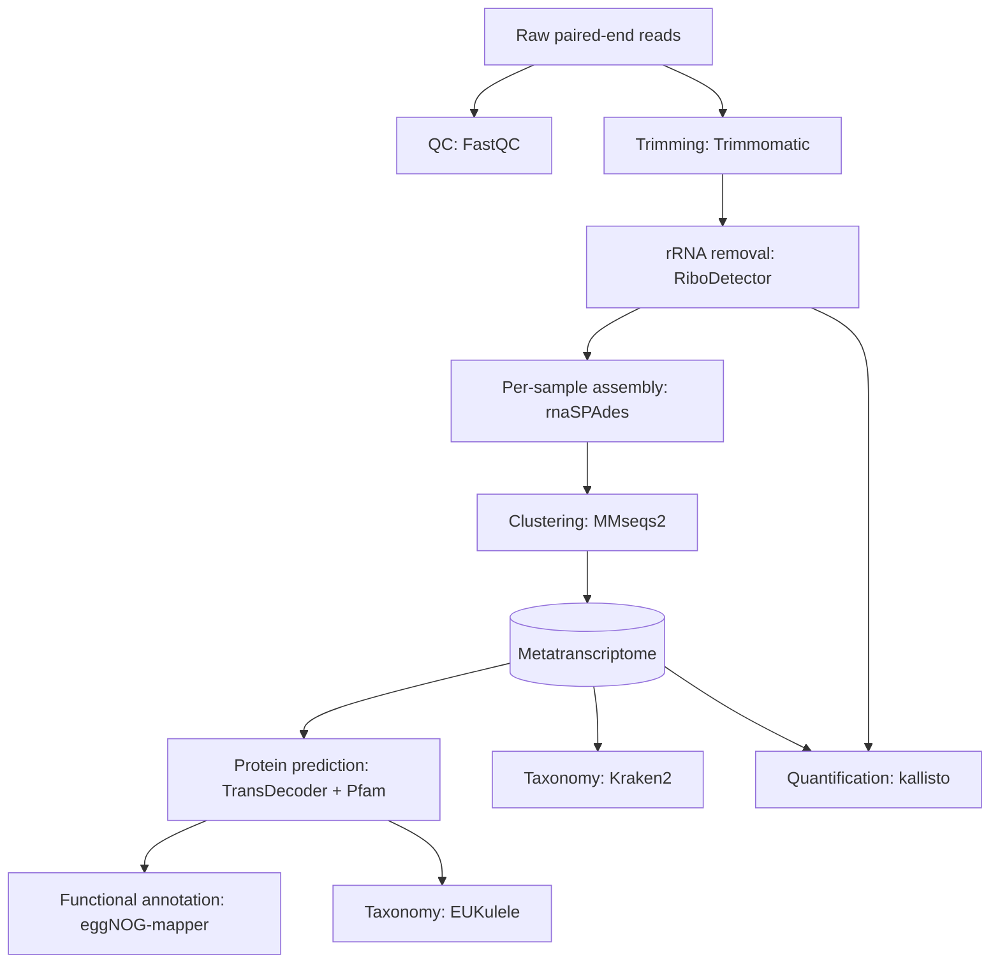

# Scheldt estuary metatranscriptomic workflow (2024)
A Snakemake workflow that turns paired-end Illumina metatranscriptome reads from microeukaryotic plankton into a co-assembled, annotated and quantified metatranscriptome. Reads are quality-checked, trimmed and depleted of rRNA, assembled per sample with rnaSPAdes, clustered into one non-redundant metatranscriptome, translated into proteins, annotated taxonomically and functionally, and quantified per sample with kallisto.

The workflow was developed for the UGent HPC (VSC, PBS/Torque scheduler) and uses a mix of environment modules and conda environments.

Contact: Nadine Rijsdijk, Michiel Perneel

## Workflow


Notes:

- **Assemble per sample, then cluster.** Each sample is assembled separately and the
  assemblies are merged by clustering at 95% nucleotide identity, which keeps the
  per-assembly memory manageable while giving one shared reference for quantification.
- **Pfam-guided protein prediction.** ORFs are first called on all transcripts, screened
  against Pfam-A with MMseqs2, and TransDecoder.Predict is then run only on transcripts
  with a Pfam hit. The protein set used for annotation is therefore restricted to
  transcripts with at least one recognisable domain.
- **Quantification uses all transcripts.** kallisto is indexed on the full
  `final_metatranscriptome.fasta`, not the Pfam-hit subset, so counts are available for
  every transcript; join with the annotations on transcript ID downstream.

## Repository layout

```
.
├── Snakefile                    # entry point; defines `rule all`
├── config_example.yaml          # template for config.yaml (copy and fill in)
├── hpc_config_example/
│   ├── config.yaml              # snakemake job submission specs
│   └── cluster.yaml             # per-rule PBS resources (nodes, ppn, mem, walltime)
├── rules/                       # one .smk file per workflow stage
├── envs/                        # conda environments
│   ├── snakemake_7.yml
│   └── ribodetector.yaml
├── scripts/
│   ├── utils.py                 # config/sample loading and sanity checks
│   ├── make_raw.sh              # links/concatenates sequencer output into data/raw/
│   ├── submit_snakemake_pbs.sh  # PBS job that launches Snakemake on the cluster
│   ├── merge_kallisto.py        # builds count/TPM matrices from kallisto output
│   └── submit_merge_kallisto.sh # PBS job wrapper for merge_kallisto.py
└── data/
    ├── samples.csv              # sample sheet (column: sample_name)
    └── illumina-adapters.fa     # adapter sequences for Trimmomatic
```

config.yaml, hpc_config/ and all large data/result folders under data/ are git-ignored.

## Requirements

### Software

**Snakemake environment** (from `snakemake_7.yml`): Snakemake 7.32.4, Python 3.12,
pandas and friends.

```bash
conda env create -f envs/snakemake_7.yml
conda activate snakemake_7
```

**Environment modules** (loaded inside rules with `module load`; names as on the UGent HPC):
- `SPAdes`
- `MMseqs2`
- `Trimmomatic/0.39-Java-11`
- `TransDecoder` and `Perl-bundle-CPAN/5.36.1-GCCcore-12.3.0`
- `SeqKit`
- `eggnog-mapper`
- `MultiQC`

**Conda environments** used by rules:
| Rule | `conda:` directive | needs to contain |
|---|---|---|
| `sample_rRNA_cleanup` | `{conda_environments}/ribodetector.yaml` | |
| `rename_transcripts` | `anvio-9` | a pre-existing **named** conda env with anvi'o 9 |
| `eukulele` | `EUKulele` | a named env with EUKulele; **pin `pandas<3`** |
| `kraken_annotation`, `kraken_read_annotation` | `kraken` | a named env with Kraken2 |
| `fastqc`, `kallisto_*` | Snakemake wrappers | created automatically with `--use-conda` |

### Reference databases

Set the paths in `config.yaml` (see below):

- **Pfam-A** multiple sequence alignment (Stockholm, e.g. `Pfam-A.seed` or `Pfam-A.full`)
  → `pfam`; the MMseqs2 profile DB is built in `pfam_dir`.
- **eggNOG-mapper data** (incl. the MMseqs2 DB, via `download_eggnog_data.py -M`)
  → `eggnog_ref_dir`.
- **PhyloDB** reference for EUKulele → `eukulele_phylodb_ref_dir` and
  `eukulele_phylodb_ref_fa`.
- **Kraken2 database** → `taxonomy_db_diatom2024` (the project used a custom 2024 DB with
  extended diatom coverage).
- *Optional:* **EukProt** protein FASTA → `eukprot_ref_fa` / `eukprot_ref_dir`.

## Setup

### 1. Clone

```bash
git clone https://github.com/MichielPerneel/metatranscriptomics-scheldt-2024.git
cd metatranscriptomics-scheldt-2024
```

### 2. Put the raw reads in place

The workflow expects one pair of gzipped FASTQ files per sample, named:

```
{raw_reads}/{sample}_R1.fastq.gz
{raw_reads}/{sample}_R2.fastq.gz
```

`scripts/make_raw.sh` does this from the sequencing provider's delivery (`{sample}_..._1.fq.gz` / `_2.fq.gz`): single-lane samples are symlinked, multi-lane samples are concatenated. Pass the delivery folder and the destination as arguments:

```bash
bash scripts/make_raw.sh /path/to/delivery data/raw
```

### 3. Sample sheet

`data/samples.csv` has one column, `sample_name`, matching the `{sample}` prefix of the
FASTQ files:

```csv
sample_name
N1
N2
N3
```

The repository ships with the 24 samples of the 2024 Scheldt campaign.

### 4. Configuration

```bash
cp config_example.yaml config.yaml
```

and fill in:

| Key | Meaning |
|---|---|
| `home_dir` | repository root |
| `samples` | path to `samples.csv` |
| `raw_reads` | folder with `{sample}_R1/R2.fastq.gz` |
| `output_dir` | where results go (e.g. `data/`) |
| `scratch_dir` | intermediates: trimmed and rRNA-depleted reads, temporary MMseqs2 files |
| `log_dir` | rule logs |
| `k_values` | rnaSPAdes k-mer sizes (default 75, 99, 127) |
| `adapters` | adapter FASTA (`data/illumina-adapters.fa`) |
| `conda_environments` | folder containing `ribodetector.yaml` |
| `scripts_directory` | `scripts/` |
| `pfam`, `pfam_dir` | Pfam-A MSA, and where to build its MMseqs2 DB |
| `eggnog_ref_dir` | eggNOG-mapper data directory |
| `eukulele_phylodb_ref_dir`, `eukulele_phylodb_ref_fa` | PhyloDB for EUKulele |
| `taxonomy_db_diatom2024` | Kraken2 database |
| `eukprot_ref_fa`, `eukprot_ref_dir` | optional EukProt reference |

On start-up, `scripts/utils.py` checks that `home_dir`, `samples`, `raw_reads`,
`output_dir`, `scratch_dir`, `adapters` and `conda_environments` exist and that both read
files are present for every sample, and stops with an error otherwise. **Create
`output_dir` and `scratch_dir` before the first run.**

### 5. Cluster profile

```bash
cp -r hpc_config_example hpc_config
```

Fill in `account`, `email`, `queue` and `outdir` in `hpc_config/cluster.yaml`, and adapt
`hpc_config/config.yaml` to your scheduler.

## Running

### Dry run

Check what will be executed first:

```bash
conda activate snakemake_7
snakemake -n --use-conda --conda-prefix .snakemake/conda
```

### Submit to the HPC (PBS)
```bash
qsub -M you@ugent.be -o logs/ -e logs/ scripts/submit_snakemake_pbs.sh
```

The driver job (1 core, 72 h) activates `snakemake_7`, redirects temporary, conda and pip
caches to scratch, and runs:

```bash
snakemake --profile hpc_config/ --use-conda --conda-prefix envs/ \
          --rerun-triggers mtime input
```

Snakemake then submits each rule as its own PBS job with the resources from
`hpc_config/cluster.yaml`. If the 72 h driver walltime runs out, resubmit it; finished
outputs are not recomputed.

### Locally / on a single large node

```bash
snakemake --use-conda --conda-prefix envs/ --cores 32
```

### Running a single target

Any output path or rule name can be requested directly, e.g.:

```bash
snakemake --use-conda --conda-prefix envs/ --cores 32 \
    data/assembly/rnaSPAdes/final_metatranscriptome.fasta
```

### After workflow completion

**Count and TPM matrices:** once all `kallisto_quant` jobs have finished, merge the
per-sample results:

```bash
qsub scripts/submit_merge_kallisto.sh
# or directly:
python scripts/merge_kallisto.py -i data/quantification -o data/quantification/
```

This writes `count.csv` (kallisto estimated counts) and `tpm.csv`, with transcripts as
rows and samples as columns. The submit script assumes `output_dir` is `data/`; adjust
the paths if not. The script treats every sub-folder of the input directory as a sample,
so run it on a folder that contains only kallisto output folders.

## Main outputs

Relative to `output_dir`:

```
quality_control/fastqc/                      # per-read-file FastQC reports
assembly/rnaSPAdes/{sample}/transcripts.fasta
assembly/rnaSPAdes/final_metatranscriptome.fasta        # clustered, ≥300 nt reference
assembly/rnaSPAdes/final_metatranscriptome.pfamhit.fasta
assembly/protein/metatranscriptome.{pep,cds,gff3,bed}   # predicted proteins
annotation/functional_eggnog/functional_annotation.emapper.annotations
annotation/taxonomy_eukulele/                           # EUKulele output
annotation/kraken/{report,output}.tsv                   # contig-level Kraken2
annotation/kraken_reads/{sample}.report.tsv             # read-level Kraken2
quantification/{sample}/abundance.{tsv,h5}
quantification/{count,tpm}.csv                          # after merge_kallisto.py
```

## Citation
If you use this workflow, remember to cite the tools it builds on: FastQC, MultiQC,
Trimmomatic, RiboDetector, SPAdes/rnaSPAdes, MMseqs2, anvi'o, TransDecoder, Pfam, SeqKit,
eggNOG-mapper, EUKulele, PhyloDB, Kraken2, EukProt and kallisto, as well as Snakemake.